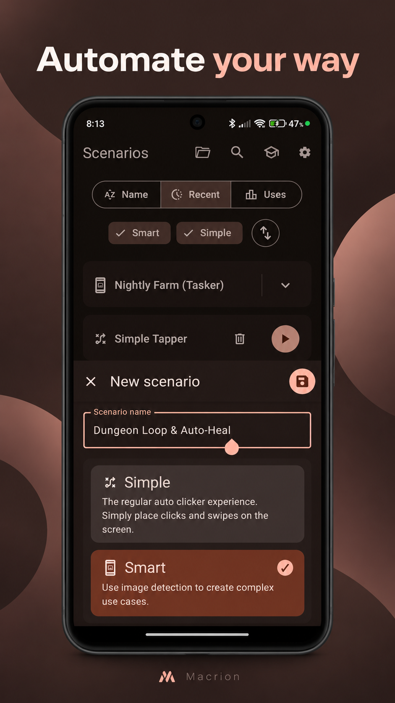
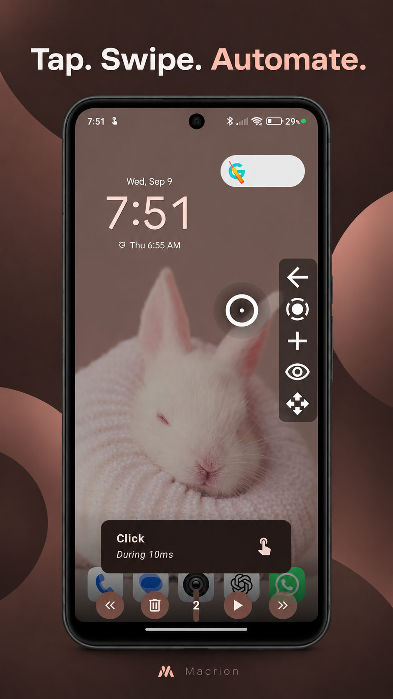
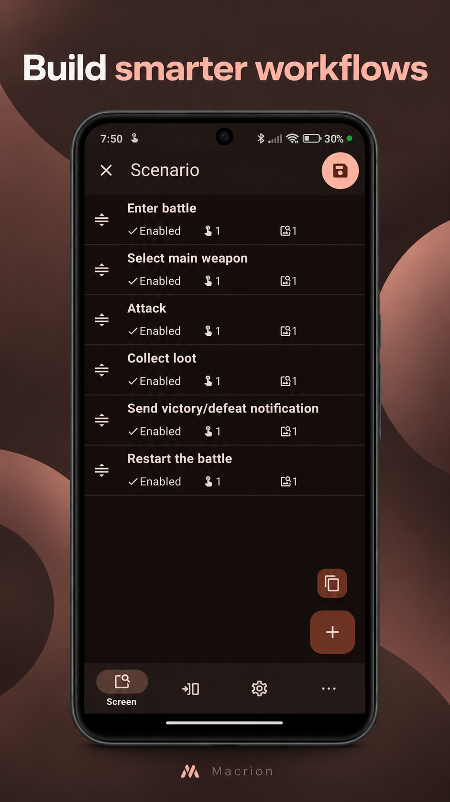

# Macrion

Macrion is a free, open-source Android app for automating taps, swipes, and other actions in your apps. Repeat a fixed sequence or have Macrion wait until a button, message, or other on-screen cue appears.

Macrion is an independent app based on [Klick'r](https://github.com/Nain57/Smart-AutoClicker), originally created by Kevin Buzeau and its contributors.

**Android 7.0 or later.** If you're downloading from GitHub and aren't sure which APK to pick, use the universal APK.

## What you can automate

- **Simple scenarios** repeat taps, long presses, and swipes at positions you place on the screen. Set the delays and how many times the sequence runs.
- **Smart scenarios** react to images, colors, text, or numbers on screen. For example, wait for a loading indicator to disappear, then tap a button wherever it appears.
- **Multi-step workflows** can use timers, counters, and cooldowns to control when actions run. Enter text, perform system actions such as Back, or integrate with other automation apps through Android intents and broadcasts.
- **On-screen controls** let you edit and test a scenario over the app you're automating. The live debug panel shows which event fired and how many times it has run.

  
  
  

Macrion uses Android Accessibility to perform actions and draws its controls over other apps. Smart scenarios also request screen capture. Image matching and text recognition run on your device.

## Moving from Klick'r

Import a supported Klick'r backup to bring your scenarios over. You can also export a Klick'r-compatible copy. Macrion shows what will change or be omitted before you save it, so keep a native Macrion backup for the complete scenario.

## Feedback

Current releases aim to keep familiar Klick'r workflows while a Python-based Advanced Mode is being prototyped.

Licensed under the [GNU General Public License v3.0 or later](LICENSE).
