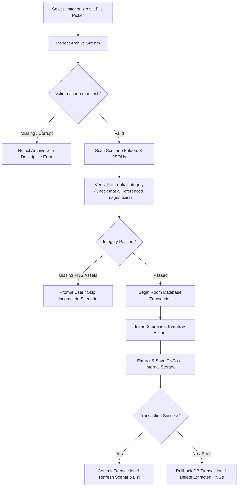

# Backup Architecture & Archive Storage

Your automation scenarios can represent hours of meticulous layout, coordinate calibration, and logic sequencing. Macrion implements an open, lossless backup architecture built on standard ZIP compression and Android's **Storage Access Framework (SAF)**, allowing you to back up, restore, and transfer your scenarios across devices with zero vendor lock-in.

---

## Compatibility with Klick’r and future versions

Use native `.macrion.zip` backups to preserve all features supported by the installed Macrion version. Klick’r-compatible export targets the explicitly named legacy format (smart schema 23, simple schema 1); compatibility with an unknown future Klick’r reader cannot be guaranteed. Export reviews show omissions and affected scenario/action names. Before/after touch delays become explicit pauses, including around repeated simple actions. Curves, multi-touch groups, counter-driven positions, condition-position counter operands, screenshot/sound actions, and external actions remain excluded from this legacy export profile.

Macrion inspects a private snapshot of a selected archive before importing. Supported Klick’r 4.1 smart and simple clicks, straight swipes, stationary presses, and representable multi-touch gestures are translated into Macrion actions, retaining start offsets, durations, literal offsets, and simple-action repeat settings. Condition-targeted smart clicks remain condition-targeted. Smart imports also support detected-condition coordinates as counter operands, counter-driven gesture coordinates, and counter-driven offsets on condition-targeted clicks. Additional expressions that combine a counter coordinate with another offset, timed movement sequences, and persistent holds require partial recovery; they are not flattened into different behavior.

Unknown schema/container versions, unknown fields and enum values, and unsupported components stop the normal import before any database insertion. **Try partial import** opens a separate review of recoverable scenario counts and compatibility notes. **Import compatible data** is a second explicit confirmation. This fallback applies to recognizable future Macrion and Klick’r layouts, including version numbers not known when Macrion was built. It is recovery, not a promise that future semantics are understood.

Unsupported actions are omitted as whole actions. An unknown condition removes its entire event, so recovery cannot accidentally broaden a trigger by dropping a restriction. Unknown scenario settings can make the whole scenario unrecoverable. References to omitted events/conditions are checked and dependent actions are omitted too. If no recognizable scenarios remain, import is disabled. Mixed-format, corrupt, and unrecognized archives do not gain a validation bypass.

The review and import use the same private ZIP snapshot. Cancelling or finishing removes the snapshot; the original selected file is left untouched. Partial imports create copies and do not start scenarios automatically. Keep the original backup and inspect recovered scenarios before running them. Re-exporting a recovered scenario includes only the data that survived recovery, not its omitted future features.

Automated tests exercise conversion, review/confirmation, future-version gates, private snapshots, and a pinned Klick’r 4.1.2 simple-scenario reader. Full smart/simple restore and replay inside Klick’r still require device verification. Native Macrion archive sub-extensions intentionally prevent accidental ingestion by Klick’r; renaming files does not convert them.

---

## The Storage Philosophy

Macrion operates under a strict offline-first, local-storage model:
- **Zero Proprietary Cloud Lock-In**: Macrion does not rely on a private server or closed cloud account to synchronize macros. All scenario data remains 100% under your ownership.
- **Android Storage Access Framework (SAF)**: Backup and restore operations utilize native Android document pickers. You can save or load backup archives directly to/from internal device storage, external MicroSD cards, USB OTG drives, or connected cloud storage providers (Google Drive, Nextcloud, Synology Drive, Dropbox).
- **Human-Readable Open Formats**: Scenarios are serialized as standard formatted JSON accompanied by raw PNG graphic assets, making them easily inspectable or version-controlled in Git.

---

## Native Macrion Archive Specification (`.macrion.zip`)

Native Macrion backups are packaged as standard `.zip` archives with a specialized internal directory structure governed by the **Macrion Backup Contract**.

```text
Macrion-Backup-2026-09-07.macrion.zip
 ├── macrion-manifest.macrion.json        <-- Archive metadata & container version
 ├── 101/                                  <-- Smart Scenario folder (ID: 101)
 │    ├── 101.macrion.json                <-- Scenario structure, events & actions
 │    ├── Condition-201.macrion.png       <-- Raw cropped condition template image
 │    └── Condition-202.macrion.png       <-- Raw cropped condition template image
 ├── 102/                                  <-- Smart Scenario folder (ID: 102)
 │    └── 102.macrion.json
 └── dumb-301/                             <-- Simple (Position-Based) Scenario folder
      └── 301.macrion.json
```

### 1. The Container Manifest (`macrion-manifest.macrion.json`)
The root manifest validates the archive identity and declares container-level specifications:
- `format`: The archive family, currently `macrion`.
- `containerVersion`: The version of the Macrion archive format, currently `1`.
- `databaseVersion`: The Macrion smart database schema version. Each scenario payload also carries its own `version`; simple scenarios use their separate database version.

The current manifest does not include an app version or creation timestamp.

### 2. Scenario Definitions (`{id}.macrion.json`)
Each scenario resides in its own numbered directory. The JSON payload encapsulates the complete hierarchical tree of the scenario:
- **Scenario Metadata**: Name, description, detection frequency, downscaling factor, and orientation settings.
- **Counters**: Initial variable names and default numeric values.
- **Events**: Priority indexes, enabled-on-start flags, cooldown delays, and condition evaluation operators (`AND` / `OR`).
- **Conditions**: Color coordinates, image template matching parameters, OCR text queries, and counter comparison operators.
- **Actions**: Ordered sequence of clicks, swipes, pauses, counter updates, event toggles, notifications, and intent configurations.

### 3. Asset Bundling (`Condition-{id}.macrion.png`)
Image conditions require reference graphic templates to evaluate cross-correlations on screen. During export:
- All cropped condition templates are extracted from Macrion's internal app storage.
- Templates are stored alongside their parent scenario JSON as lossless 24-bit/32-bit PNG files.
- The scenario JSON references these assets strictly by file naming convention (`Condition-201.macrion.png`), ensuring complete portability when transferred to other devices.

---

## The Sub-Extension Invariant (`.macrion.*`)

A defining design decision of native Macrion backups is the **`.macrion` sub-extension invariant**:

$$\text{filename} = \text{base} + \text{".macrion"} + \text{extension}$$

Notice that every file inside the archive is named with `.macrion` preceding its standard extension:
- `macrion-manifest.macrion.json`
- `101.macrion.json`
- `Condition-201.macrion.png`
- `.macrion.zip`

### Why This Invariant Exists
Macrion is derived from Klick'r, which also uses `.zip` backups containing `101.json` and `Condition-201.png`. 

However, Macrion's database schema includes powerful features that Klick'r does not support (e.g., neural NCNN text OCR, counter triggers, broadcast receivers, dynamic `{counter}` interpolation, and system global navigation actions). 

If an older Klick'r installation attempts to read a native Macrion backup:
- Without the sub-extension, Klick'r's parser would attempt to ingest the newer JSON schema, encounter unknown entity types, and crash or corrupt the user's database.
- **With the sub-extension**: Klick'r's file matchers ignore `.macrion.json` and `.macrion.png` entries completely, cleanly preventing accidental data corruption.

---

## Exporting Scenarios

You can generate backup archives directly from the Macrion interface:

1. Open **Macrion** ➔ Navigate to the **Backup & Restore** tab (or three-dot top menu).
2. Tap **Export Scenarios**.
3. Choose your export scope:
   - **All Scenarios**: Compiles every Smart and Simple scenario into a consolidated master archive.
   - **Select Scenarios**: Check individual scenarios to package a specific automation routine (e.g., to share with a friend or upload to a repository).
4. Select a destination in Android's Storage Access Framework file picker.
5. Macrion bundles the JSON structures and graphic assets into a `.macrion.zip` file.

> [!TIP]
> Keep regular backup exports before performing Android OS system upgrades or switching phones.

---

## Import Pipeline & Validation Boundaries

When importing a `.macrion.zip` backup, Macrion executes a multi-stage validation pipeline to safeguard your existing scenario library:



### Referential Integrity & Orphan Prevention
- **Missing Asset Detection**: If a scenario JSON references `Condition-456.macrion.png` but the image file is missing from the archive, Macrion alerts you before importing rather than silently creating broken conditions.
- **Staging and Database Rollback**: Archive validation and recovery review happen before live data is written. Image promotion rolls back newly copied files if promotion fails, and each scenario’s database insertion runs in a transaction. A failed scenario copy rolls back its rows; other successfully imported copies can remain. File promotion and database insertion are separate stages, so this is not an archive-wide transaction.
- **ID De-Duplication**: Scenario, event, condition, and action database IDs are dynamically re-assigned upon import. Importing an archive never overwrites or collides with existing scenarios in your library, even if they share the same original numerical IDs.
